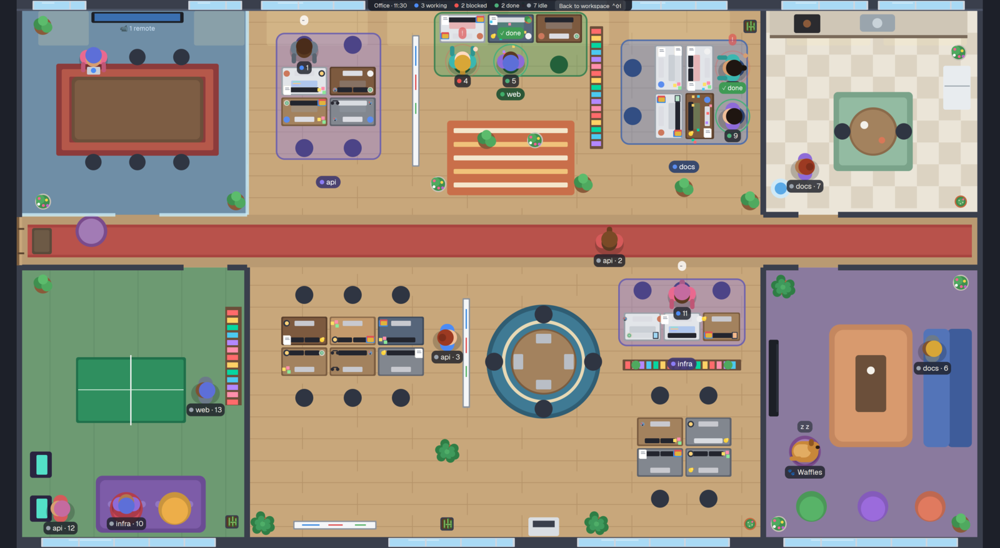

# Officetime

A top-down pixel office for [Herdr](https://herdr.dev) that fills the whole window, inspired by [DustyPolk/herdr-office](https://github.com/DustyPolk/herdr-office). Every coding agent is a coworker with a desk. Each Herdr space is a team with its own desk group. Busy agents sit and type. Idle ones get up and wander off to the kitchen, the lounge or the game room. Press a key to look in on them, and press it again to get back to your terminals.

## What you see

The floor plan has a meeting room, a game room, a kitchen and a lounge off a long hallway, with an open office in the middle.

- **Teams.** Each space gets its own desk group: the smallest free one that fits all its agents. The group's rug and chairs take the space's color from the sidebar, and a sign shows the space's name. There are seven groups with different setups: pods of four and six, benches, facing pairs, and a round table. Whiteboards, bookshelves and plants sit between them.
- **Working:** the agent sits at its desk and types, with code scrolling on its screen.
- **Blocked:** a raised hand, a pulsing red ring and a "!" that turns into "HELP!!" after five minutes.
- **Done:** a green check and confetti until you look at the terminal.
- **Idle:** the agent gets up and runs around. It goes for coffee, chats at the water cooler, raids the fridge, plays ping pong or the arcade, looks out the window, or sinks into a beanbag. After ten idle minutes it naps on the couch. An idle agent whose sub-agents (`hc run`) are still running stays in its chair.
- **Remote agents** (on another machine) join from the meeting room, on laptops.
- **New agents** walk in through the front door, and closed ones walk out carrying a box.
- **Day and night** follow the clock: pink at dawn, sunlight through the windows by day, an orange dusk, then dimmed lights and desk lamps at night.
- **Waffles**, the office dog, trots around, begs in the kitchen and sleeps in its beds. Hover over the dog to see what it's up to.

Hover over an agent to see its tab, program, status and how long it has been idle or blocked. Click it to go back to the workspace with its terminal focused.

## Install

1. Copy `layouts/office-full.json` and `layouts/office-full.svg` into `~/.config/herdr-app/layouts/`.
2. Copy `mods/office-top/` into `~/.config/herdr-app/mods/`.
3. Merge `keys.json` into `~/.config/herdr-app/keys.json`:
   - `ctrl-shift-i` opens the office from anywhere.
   - `ctrl-shift-i` or `Esc` takes you back to the `main` layout.
4. Run `herdr-app check ~/.config/herdr-app/mods/office-top`.

## Settings

Constants at the top of `mods/office-top/main.js`:

| Setting | Default | What it does |
|---|---|---|
| `WORKSPACE` | `"main"` | The layout that Back, the toggle key and clicking an agent return to |
| `DEMO` | `0` | Set to e.g. `14` to fill the office with pretend agents in every state |
| `DAY_LENGTH` | `0` | `0` follows the real clock. A number of minutes runs a whole day that fast. |
| `DOG_NAME` | `"Waffles"` | The dog's name |
| `PERSON` | `1.55` | How big people are |
| `STAY` | 45–120 s | How long an idle agent stays somewhere before moving on |
| `NAP_AFTER` | 10 min | Idle time before an agent naps |
| `ALARM_AFTER` | 5 min | Blocked time before the HELP!! alarm |

The mod only reads Herdr's own data. It makes no network requests, runs no programs and touches no files. The desk seating it remembers is kept in the mod's local storage.

## License

MIT. See [LICENSE](LICENSE). [RECIPE.md](RECIPE.md) describes everything it does and how it's built.
