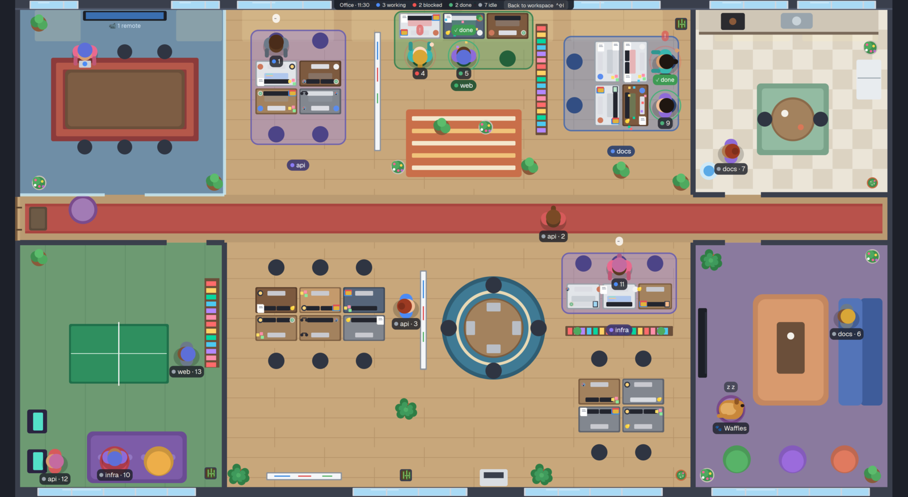

# Officetime

A top-down pixel office that fills the whole Herdr window. Every local agent is a coworker with a desk, and each space is a team with its own desk group. Busy agents sit and type, blocked ones raise a hand, and finished ones get confetti. Idle ones walk the hallway to the kitchen, the lounge and the game room. Agents on other machines join from the meeting room, a dog called Waffles lives here, and the light follows the time of day. `ctrl-shift-i` opens it and takes you back to the workspace.

## What you see

The whole window is one mod (`office-top`). It draws a floor plan of 44 × 25 tiles, scaled to fit and centred: tile size `U = min(width / 44, height / 25)`, on a `#1d2029` background. Everything is positioned in tiles. People are drawn at 1.55 tiles (`PERSON`).

- **Walls.** The top and bottom outer walls are 0.5 tiles thick, the sides 0.25 (`#3a3f4c`). The front door is a gap in the left wall at the hallway (y 9.9–12.1), with a doormat. Inside walls are 0.26 tiles thick (solid `#3a3f4c`) or 0.16 (glass `#c9ecf8cc`). Their gaps are the doors.
- **Windows.** There are 16 framed windows in the top and bottom walls (frame `#cfd6df`, mullions every 1.6 tiles). They show the sky color for the hour, a glint by day and stars at night.
- **The hallway.** It runs across the whole office at y 9.8–12.2 (corridor line `C = 11`), with a red runner (`#a8443f` / `#b8524b`).
- **Meeting room** (top left, x 0.25–10.5, y 0.5–9.8, carpet `#6f8ea6`). Glass walls with a door at x 4.5–6.5. A long table on a red patterned rug, six chairs, and a wall screen that reads "📹 N remote" or "MEETING".
- **Game room** (bottom left, carpet `#6d9a72` with stripes). A door at x 7.6–9.6. A ping pong table at x 2.7–7.7, y 16.3–19.3, two arcade cabinets on the left wall, two beanbags on a purple shaggy rug, and a bookshelf.
- **Kitchen** (top right, x 34–43.75, checkered tiles `#ebe5d8` / `#dcd3c2`). A door at x 35.6–37.4. A counter along the top wall with a coffee machine and a sink, a fridge, a round table with two chairs on a green rug, and a water cooler.
- **Lounge** (bottom right, carpet `#8a7a9e`). A door at x 35.6–37.4. A couch along the right wall, a coffee table on a rug, a TV on the left wall, three beanbags and a dog bed. A second dog bed sits in the hallway by the front door.
- **The open office** (x 10.5–34, wood floor `#c8a77b` with planks). There are seven desk groups:
  - a pod of 4 (2 × 2)
  - a bench of 3 facing the top windows
  - two facing pairs across sideways desks
  - a pod of 6 (2 × 3)
  - a round table with 4 laptops
  - a bench of 3 backed by a bookshelf
  - a corner pod of 4

  Between them are two standing whiteboards, a bookshelf, a wall whiteboard, a printer, a striped runner rug and a round rug under the round table. Plants are scattered around in five kinds (bush, palm, flowering, snake plant, cactus), picked by position.
- **Desks.** Each desk picks one of six finishes by its id: oak, walnut, white, grey, honey or slate blue. Some have two monitors or a white monitor. Up to three things sit in the free corners: a plant, succulent, lamp, books, papers, sticky notes, headphones, a rubber duck, a photo or pens.
- **People.** Seen from above:
  - a shadow, then shoulders in the shirt colour
  - a head drawn as a skin disc under a hair disc that is set back, so the face shows as a crescent at the front
  - some have a ponytail or a bun, and about one in 23 is bald
  - looks are picked by hashing the terminal address
- **Name tags.** A dark pill under each person, with a status dot. At a desk it shows the tab name; elsewhere it shows `space · tab`.
- **Teams.** A desk group in use gets a rug in its space's sidebar colour (`shared("space.colors")`, mapped like the `spaces` mod), with a darker border. Its chairs take that colour too, and a sign shows the space name.
- **The HUD.** A bar on the top wall, centred: "Office · HH:MM", counts for working, blocked, done and idle, and a "Back to workspace ⌃⇧I" button.

## How it behaves

- **Working:** at the desk, arms typing. The screen glows blue, with three code lines animating. A "···" bubble cycles above.
- **Blocked:** at the desk, with a hand raised and a red pulsing ring. A red "!" bubble shows, and after 5 minutes (`ALARM_AFTER`) it becomes a fast-blinking "HELP!!".
- **Done:** at the desk, with a green ring, a "✓ done" bubble and confetti falling over the desk, until you look at the terminal and it turns idle.
- **Idle:**
  - The agent leaves its desk for a hangout, picked by weight: coffee, fridge, water cooler, kitchen table, ping pong, arcade, beanbags, couch, windows, whiteboards, printer, or a spot in the hallway.
  - Once there, every 7 s it has a one-in-three chance of saying something in a wide white bubble. Half the time it's general tech babble (`BABBLE`): agents joking about being agents, and debugging war stories. The other half it's a line about the spot it's at (`SPOT_BABBLE`, by spot name without the number), such as "brewing a hotfix" at the coffee machine or "ping… pong… ACK" at the table. Hallway strolls only use the general lines.
  - It stays 45–120 s (`STAY`) and then moves on. With both ping pong spots taken, a ball bounces between the two paddles.
  - After 10 idle minutes (`NAP_AFTER`) it takes a couch seat or a beanbag for 5 minutes, with a floating "z z" (now and then "z z · collecting garbage").
  - An idle agent whose sub-agents (`hc run`, the terminal's `parent`) are still live stays in its chair.
- **Walking:** people walk at 3.4 tiles/s, one straight leg at a time. A walk goes out along one spot's path to the hallway, along it, and in along the other spot's path, so nobody crosses furniture or walls. Feet swing while walking.
- **Arrivals and departures:** new agents come in at the front door. Closed agents walk out to it carrying a box.
- **Remote agents** (an address with a machine prefix, `machine/tN`) sit at the meeting table with a laptop and a status dot, up to six. They don't walk.
- **Seating:**
  - Each space gets the smallest free group that fits all its agents. Its agents fill that group first, then free groups, then any free seat.
  - Seats and teams are remembered in the mod's `localStorage` (`officeTop.desk2`, `officeTop.team`), so they survive layout switches.
  - With all 28 seats taken, extra agents stand in the hallway.
- **Day and night:**
  - **The clock:** the light follows the real clock. `DAY_LENGTH` set to a number of minutes runs a whole day that fast.
  - **The sky in the windows:** it moves through keyframes, from night `#101833` to dawn `#e9a58a`, day `#a9daf5`, dusk `#f2a06b` and back to `#101833`.
  - **Darkness:** a navy overlay (`#0b1030`) goes up to 0.34 opacity at night, and a warm one (`#ff8a4c`) up to 0.14 at dawn and dusk.
  - **Light:** by day, sunlight patches fall below the top windows and drift with the hour. At night, occupied desks get lamp glows.
  - **December:** a tree appears in the lounge.
- **Waffles:**
  - A golden dog drawn at 1.6 tiles. While walking at 2.4 tiles/s its legs move and its tail wags. It sleeps curled up in its beds.
  - It picks a new spot every 12–32 s, or 40–60 s when it goes to a bed: one of the two beds, the kitchen table (begging), the whiteboard, a window, the ping pong table, a beanbag, or the hallway.
  - It has a "🐾 Waffles" name tag. Now and then a "woof!" bubble appears while it's up, and "z z" shows while it's asleep.
- **Hover** an agent: a card shows `space · tab`, the terminal title, the program, the status, and how long it has been idle or blocked. Hover Waffles for what it's doing ("Dreaming of squirrels", "Doing the sad eyes for snacks", ...) and a mood.
- **Click** an agent: `pane.focus` its pane, then `layout.switch` to `main`.
- **Keys:** `ctrl-shift-i` (global) opens the office. Inside it, `ctrl-shift-i` or `Esc` go back to `main`.

## Built from

- **The layout:** `layouts/office-full.json` is a root `column` with a single block `{ "mod": "office-top" }`, and preview `layouts/office-full.svg`.
- **The mod:** `mods/office-top/main.js` and `mod.json` (`{ "place": "none" }`). It draws only `div`s, absolutely positioned in tiles: rectangles, with rounded ones for circles.
- **Herdr functions:** `agents()`, `terminals()` (sub-agents through `parent`), `spaces()` (each tab's `changed_at`, for idle and blocked times), `shared("space.colors")`, `setAgentOrder`, and `run("pane.focus" | "layout.switch")`.
- **Size:** taken from `on_size_change` on the root `div`.
- **Movement:** walkers are redrawn at each leg's target with `.transition("left" | "top", { duration, easing: "linear" })`. A timer runs once per leg, so the next leg starts when this one ends. Everything else that moves is native: `.loop(...)` for typing, feet, tails, confetti, the ping pong ball and pulsing rings, and `.frames(...)` for the typing bubble.
- **Timers:** every 2.5 s (idle stays and the dog), and every 30 s for the clock (faster with `DAY_LENGTH`). No timer drives animation.
- **Settings:** constants at the top of `main.js`: `WORKSPACE`, `DEMO` (pretend agents in every state), `DAY_LENGTH`, `DOG_NAME`, `PERSON`, `SPEED`, `STAY`, `NAP_AFTER` and `ALARM_AFTER`.
- **No programs, network or files:** it runs no programs, makes no network requests and touches no files.

## Watch out

- **Measure the size:** draw from `on_size_change` with a sensible default (1600 × 900). Paint full-width things with `left(0).right(0)` or `size_full`, so a size that comes late never leaves bare strips.
- **Animate with transitions:** never animate walks with a timer that notifies often. Set each leg's target once, with a transition of that leg's duration. A brand-new walker must render once at its start point before its first leg, or it pops straight to the target.
- **Plan paths along the corridor:** every spot needs a path out to the corridor line, and that path must miss furniture and pass through a door. Straight-line walks cut through desks and walls.
- **Heads:** a skin disc set back under the hair (a crescent face) reads better from above than a face disc on top of the hair. A face on top looks bald, and an outline around the head looks wrong.
- **Napping:** nappers sit like everyone else. A lying-down pose looked broken from above.
- **Sub-agents:** Claude Code's own subagents run inside the parent process. Herdr can't see them, and the parent simply shows as working. Only `hc run` sub-agents are visible.
- **Space colours:** a space without a stored colour uses `ansi6`, like the sidebar does.

## Done when

- `herdr-app check mods/office-top` passes, and `herdr-app status` shows no errors with the layout open.
- `ctrl-shift-i` opens the office from `main`, and `ctrl-shift-i` or `Esc` go back.
- With `DEMO = 14`:
  - Agents of each space sit together in one group, with that space's rug, chairs and sign.
  - Working, blocked and done desks look as described.
  - Idle agents walk out through doors and along the hallway without crossing furniture.
  - The remote agent sits in the meeting room.
- With `DAY_LENGTH = 10`, the windows go through dawn, day, dusk and night within ten minutes, with the overlay, sunlight and lamps following.
- Clicking an agent switches to `main` with its pane focused.
- Waffles moves between spots, sleeps in a bed, and shows a card on hover.
